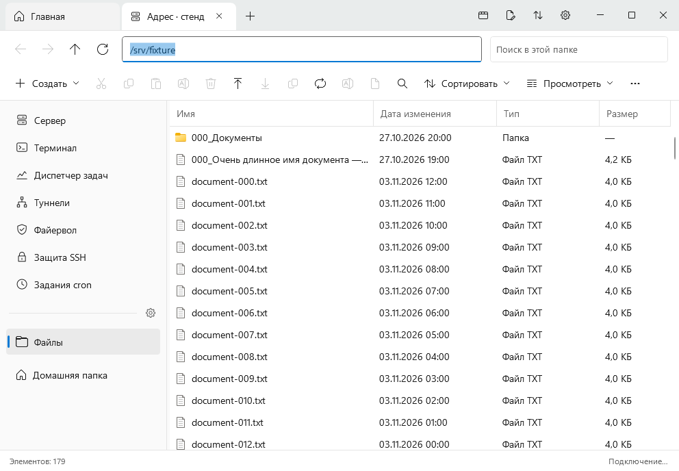
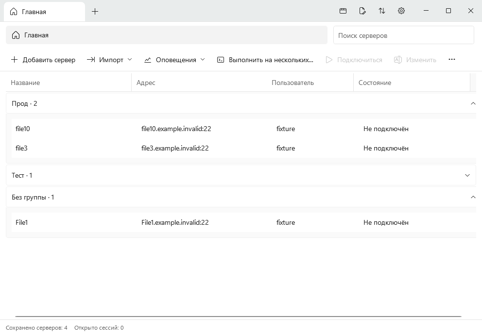
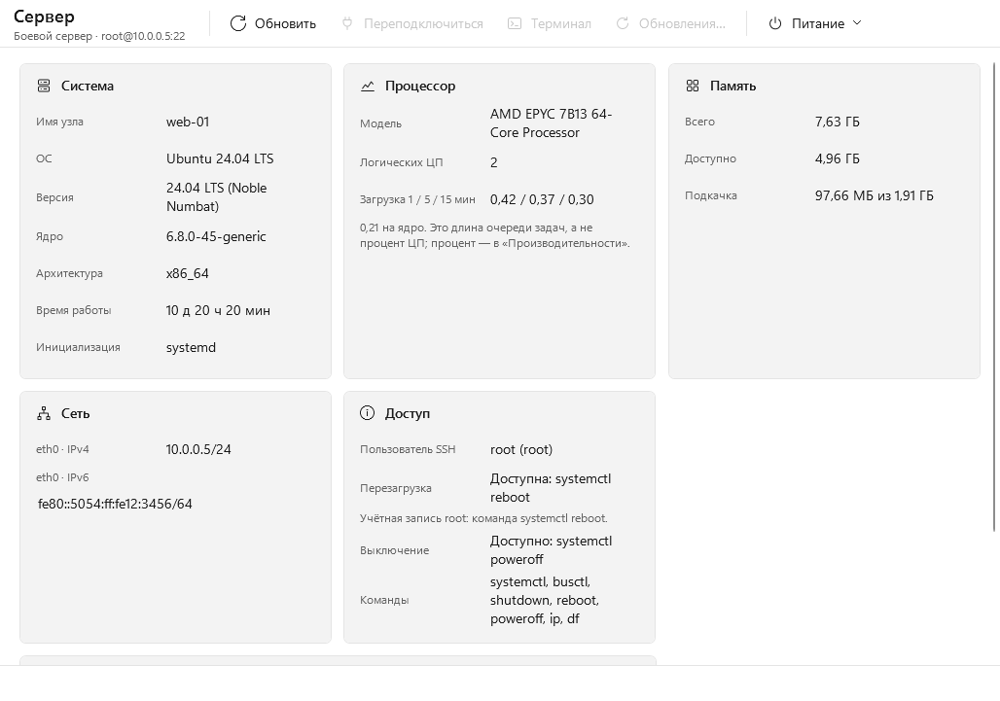
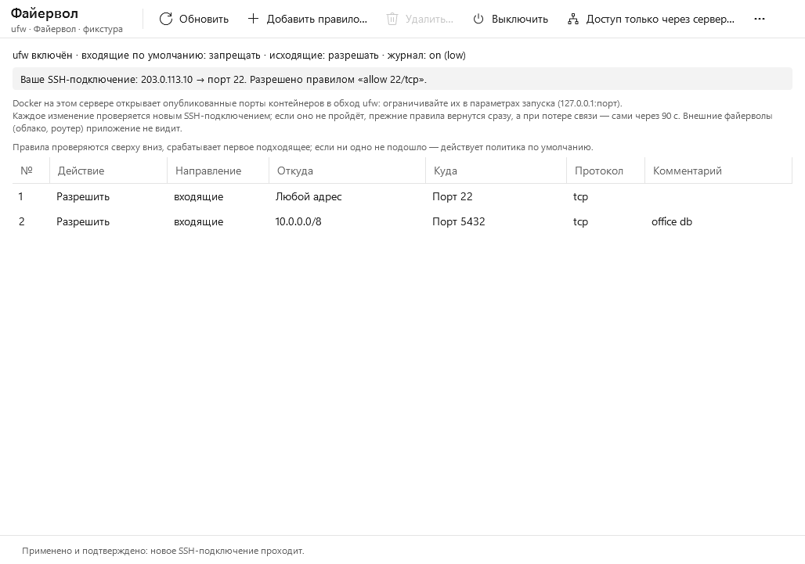
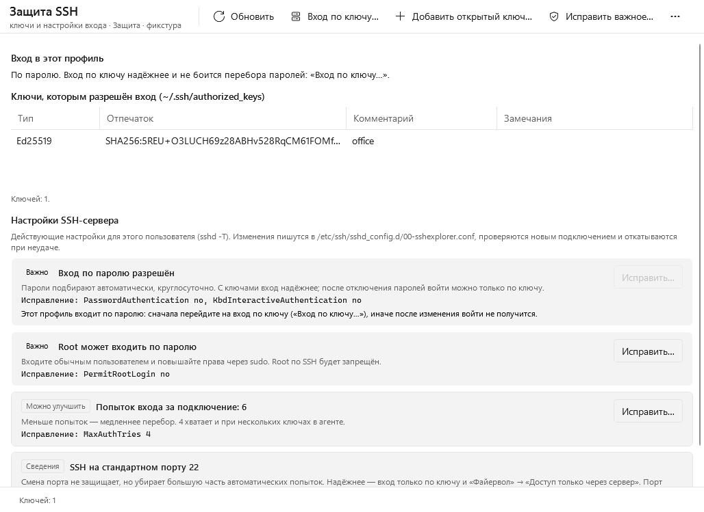
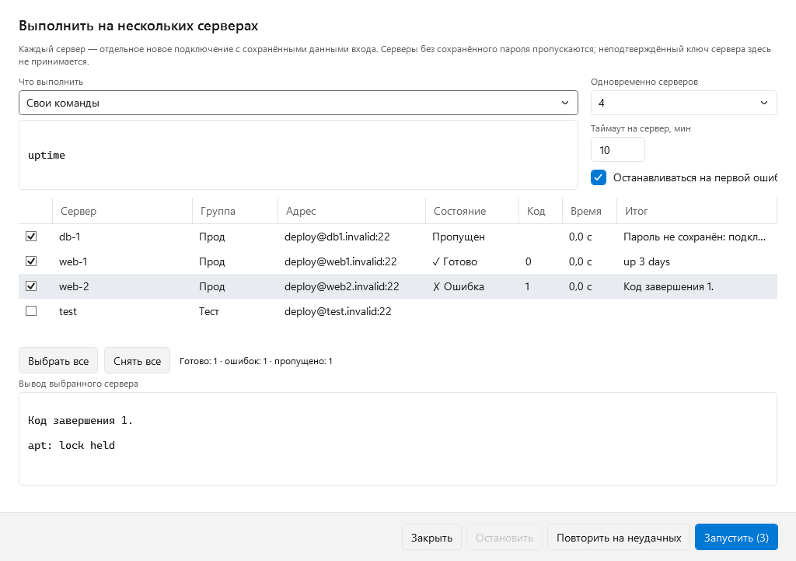
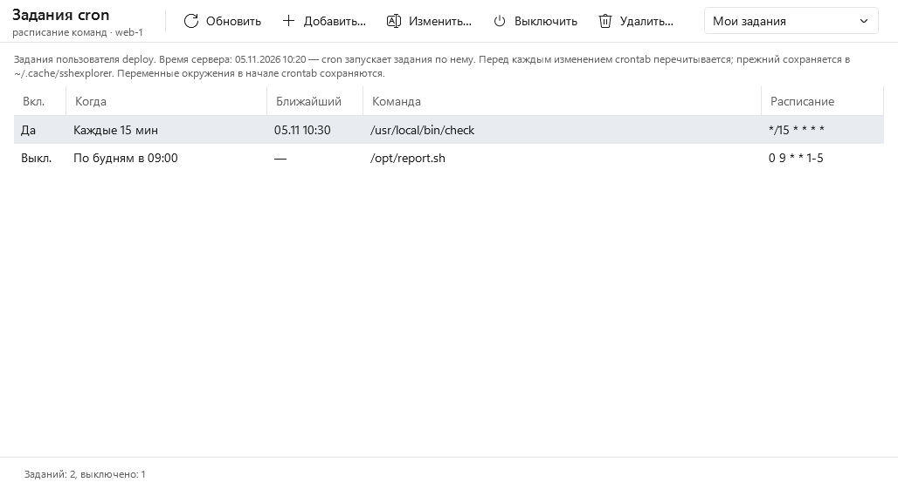
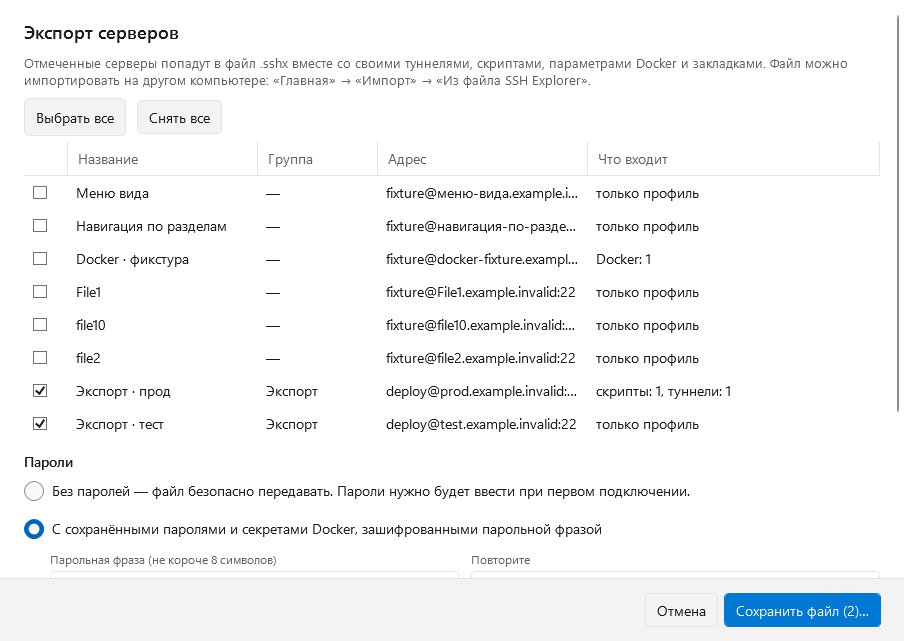
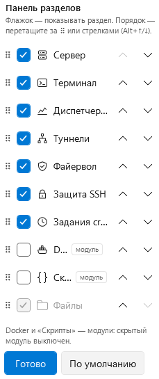

# SSH Explorer

SSH/SFTP-клиент для Windows 11 с русским интерфейсом. Файлы на сервере выглядят и работают как в Проводнике; рядом — настоящий терминал, диспетчер задач Linux, службы systemd, файервол ufw, защита SSH, задания cron, Docker и сохранённые скрипты — на одном сервере или сразу на нескольких. На сервер ничего не устанавливается.

[](https://github.com/Jetvac/ssh-explorer/actions/workflows/windows.yml)
[](https://github.com/Jetvac/ssh-explorer/actions/workflows/linux-core.yml)



## Версии

| Версия | Состояние | Где взять |
|---|---|---|
| **0.4.0** | последний выпуск | [Выпуски](https://github.com/Jetvac/ssh-explorer/releases/tag/v0.4.0) |
| 0.3.1 | предыдущий выпуск | [Выпуски](https://github.com/Jetvac/ssh-explorer/releases/tag/v0.3.1) |

Промежуточные сборки между выпусками — артефакт `SSHExplorer-<коммит>-win-x64` у каждого успешного [Windows CI](https://github.com/Jetvac/ssh-explorer/actions/workflows/windows.yml).

Что изменилось в каждой версии — [CHANGELOG.md](CHANGELOG.md). План 0.4 и его состояние — [docs/ROADMAP_0.4.md](docs/ROADMAP_0.4.md).

## Запуск

1. Скачайте `SSHExplorer-<версия>-win-x64.zip` со страницы выпуска.
2. Распакуйте **всю папку** и запустите `SSHExplorer.exe` внутри неё. Файлы рядом с EXE нужны: один EXE отдельно не запустится.
3. На «Главной» нажмите «Добавить сервер» или импортируйте профили из `~/.ssh/config`, PuTTY, WinSCP, mRemoteNG или файла `.sshx` с другого компьютера.
4. При первом подключении сверьте отпечаток ключа сервера с тем, что дал администратор.

.NET устанавливать не нужно — он внутри папки. Терминал использует WebView2, который уже есть в Windows 11. Приложение **не подписано**, поэтому Windows может предупредить о неизвестном издателе.

## Как это выглядит

Снимки сделаны автоматически в CI на текущей сборке, с тестовыми данными.

| | |
|---|---|
| <br>Главная: группы серверов, импорт, оповещения | <br>Сведения о сервере, питание, обновления пакетов |
| <br>Файервол ufw и доступ вашего SSH-подключения | <br>Ключи и проверка настроек SSH-сервера |
| <br>Скрипт сразу на нескольких серверах | <br>Задания cron словами, с ближайшим запуском |
| <br>Экспорт серверов в файл .sshx | <br>Порядок и видимость разделов — прямо в панели |

## Возможности

### Подключения
- Вход по паролю, ключу (в том числе с паролем к ключу) и keyboard-interactive.
- Вход через **SSH-агент**: OpenSSH для Windows, `SSH_AUTH_SOCK` или **Pageant** (PuTTY).
- **Промежуточные узлы (ProxyJump)**, до трёх; промежуточный сервер выбирается из сохранённых. Пароль никогда не уходит другому узлу.
- Импорт профилей из `~/.ssh/config`, PuTTY, WinSCP и mRemoteNG; группы серверов на «Главной».
- **Экспорт серверов в файл `.sshx`** и импорт на другом компьютере: профили с туннелями, скриптами, параметрами Docker и закладками. Пароли — только по выбору и зашифрованные парольной фразой.
- **Проверка обновлений** раз в день по выпускам GitHub; ничего не скачивается и не устанавливается само.
- Каждая вкладка — отдельное подключение со своей папкой, историей и терминалом. Вкладки закрываются средней кнопкой мыши.

### Файлы
- Дерево папок, адресная строка, история, закреплённые папки, восемь видов как в Проводнике, сортировка и колонки.
- Создание, переименование, копирование, перемещение, удаление и свойства с правами доступа.
- Перетаскивание и Ctrl+C/Ctrl+V между сервером и Windows; очередь передач с прогрессом и отменой.
- Редактирование в Блокноте или другом редакторе с проверенным сохранением на сервер по Ctrl+S.
- Поиск по имени в папке и во вложенных папках; миниатюры и просмотр PNG/JPEG.
- **Докачка** прерванных передач, 1–8 одновременных передач и лимит скорости.
- Пакетное переименование с предпросмотром; владелец по имени и биты setuid/setgid/sticky в свойствах.
- **Сравнение папки** на сервере с папкой Windows и копирование различий.
- **Архивы** tar.gz / tar.xz / tar.bz2 / tar / zip: сжатие и распаковка на сервере без перезаписи существующих файлов.
- **Поиск в файлах** (grep на сервере) с переходом к найденной строке; просмотр текста по F3.
- **«Копировать на другой сервер…»** — в папку открытой вкладки другого сервера.

### Терминал
- Настоящий SSH-терминал: UTF-8, цвета, полноэкранные программы, поиск, масштаб шрифта.
- Ctrl+C копирует выделение, Ctrl+V вставляет, выполняемую команду прерывает кнопка «Прервать». Прежние клавиши (Ctrl+Shift+C/V) можно вернуть в «Параметрах».
- До четырёх терминалов рядом или друг под другом (Ctrl+Shift+D / E, закрыть — Ctrl+Shift+W); у каждого своя оболочка.
- **Фрагменты команд**: вписать или выполнить сохранённую команду; **«Во все терминалы»** — ввод сразу во все терминалы вкладки.

### Туннели
- Переадресация портов: с компьютера на сервер (`ssh -L`) и с сервера на компьютер (`ssh -R`). Туннели сохраняются для сервера, открываются вручную или при подключении; видны состояние и число соединений.
- По умолчанию порт слушается только на `127.0.0.1`; открыть его для других компьютеров можно лишь после явного подтверждения.

### Файервол и доступ
- Раздел **«Файервол»** (ufw): правила по адресам, подсетям IPv4/IPv6, портам, диапазонам и протоколам; готовые варианты (SSH, веб, базы данных, DNS), политика по умолчанию, включение и выключение. Перед применением видны точная команда и то, пройдёт ли после неё ваше SSH-подключение.
- **Безопасное применение**: состояние ufw сохраняется, ставится таймер возврата, а изменение проверяется новым SSH-подключением. Не прошло — правила возвращаются сразу; связь потеряна — вернутся сами через 90 секунд.
- **«Доступ только через сервер»**: SSH к серверу закрывается для всех, кроме промежуточного сервера и указанных адресов. План и расчёт доступа показываются заранее.
- **Наборы правил**: правила одного сервера сохраняются и применяются к другому — недостающие добавляются, или сервер становится точной копией набора.

### Защита SSH
- Ключи, которым разрешён вход на сервер (`authorized_keys`): добавить, удалить, найти слабые.
- **«Вход по ключу…»**: ключ Ed25519 создаётся на этом компьютере и ставится на сервер; профиль переключается на ключ только после успешного входа новым подключением.
- **Проверка настроек SSH-сервера** (`sshd -T`): вход по паролю, root, пустые пароли, попытки входа. Исправления — одной кнопкой, с проверкой нового подключения и возвратом.

### Несколько серверов
- **«Выполнить на нескольких…»**: команды или сохранённый скрипт на выбранных серверах параллельно; таблица результатов с выводом каждого, повтор на неудачных.
- **Оповещения**, пока приложение открыто: почти заполненный диск, упавшая служба, ошибка автоматического скрипта — уведомлением Windows и списком на «Главной».

### Диспетчер задач и сервер
- «Процессы»: поиск, сортировка, завершение процессов с подтверждением.
- «Производительность»: графики CPU, памяти, дисков и сети.
- Раздел «Сервер»: ОС, ядро, CPU, память, диски, сеть; перезагрузка и выключение с подтверждением.
- **Занятые порты** с поиском: какой процесс и какой пользователь их держит.
- **«Службы»**: службы systemd, их состояние и автозапуск; запуск, остановка, перезапуск с подтверждением; журнал выбранной службы в реальном времени.
- **Журналы файлов** (`tail -F`) с фильтром текстом или регулярным выражением.
- **Задания cron** словами, с ближайшим запуском по времени сервера: добавить, изменить, выключить, удалить; изменённый на сервере crontab не перезаписывается.
- **Обновления пакетов** (apt, dnf, yum): сколько доступно, какие из них — безопасности, нужна ли перезагрузка. Команда установки вписывается в терминал, пароль sudo вводится там.

### Левая панель и модули
- Порядок и видимость разделов настраиваются прямо в панели: шестерёнка на разделителе над «Файлами» или правый щелчок. Перетаскивание, стрелки, «По умолчанию»; изменения сразу видны во всех вкладках.
- Модули по умолчанию скрыты и включаются флажком в той же панели:
- **Docker**: контейнеры, статусы, журналы, запуск и остановка; сохранённые параметры запуска с переменными окружения «ключ — значение» и быстрое пересоздание.
- **Скрипты**: сохранённые последовательности команд; запуск вручную, при подключении, по интервалу или ежедневно в заданное время.

## Безопасность

- Ключ каждого сервера проверяется при каждом подключении, изменённый ключ блокирует вход.
- Пароли и ключи сохраняются только по вашему выбору и шифруются Windows (DPAPI). В файлах настроек их нет.
- Секретные значения env для Docker и тексты скриптов передаются на сервер временными файлами с закрытыми правами и не видны в списке процессов.
- Изменения файервола выполняются только с проверкой нового подключения и автоматическим возвратом; закрыть SSH «только через сервер» можно лишь при подключении через этот сервер.
- В файл `.sshx` пароли попадают только по вашему выбору и только зашифрованными парольной фразой (PBKDF2-SHA256 → AES-256-GCM). Автоматические скрипты из файла приходят приостановленными.
- Изменения `sshd` применяются так же, как файервол: проверка `sshd -t`, новое подключение, возврат. Вход по паролю нельзя отключить, пока профиль сам входит по паролю.
- Права никогда не повышаются втихую: `sudo` используется только без пароля и только там, где сервер это разрешил. Приложение об этом сообщает.
- Удаление на Linux окончательное, корзины нет; перед удалением показывается, что именно будет удалено.

Ограничения SFTP и подробности — [docs/CORE_LIMITATIONS.md](docs/CORE_LIMITATIONS.md), [docs/REMOTE_EDIT.md](docs/REMOTE_EDIT.md), [docs/AUTH_NETWORK.md](docs/AUTH_NETWORK.md).

## Требования

- Windows 11 x64 (на Windows 10 не проверялось).
- Сервер с SSH. Для файлов нужен SFTP, для диспетчера задач — `/bin/sh` и `/proc`. Для служб нужен systemd, для архивов — `tar`/`zip`, для файервола и настроек `sshd` — ufw и root или `sudo` без пароля, для заданий — `crontab`. Если чего-то нет, приложение объясняет, что недоступно, и ничего не устанавливает.

## Где хранятся данные

`%LOCALAPPDATA%\SSHExplorer`:

| Файл или папка | Что там |
|---|---|
| `settings.json` | профили, закреплённые папки, вид, порядок разделов панели, параметры Docker и скриптов, наборы правил, фрагменты команд (секреты — только в зашифрованном виде) |
| `hostkeys.json` | подтверждённые ключи серверов |
| `secret-*.dpapi` | сохранённые пароли и passphrase, зашифрованные DPAPI |
| `TransferCache` | временные файлы для Ctrl+C в Windows |
| `Logs` | короткий журнал ошибок без команд, содержимого и секретов |

## Сборка из исходников

Нужны Windows x64, Git и .NET SDK 10.0.403 (закреплён в `global.json`).

```powershell
.\scripts\Bootstrap-Sdk.ps1
.\scripts\Build-Release.ps1 -RequireClean -SkipTests
```

Результат: `artifacts/SSHExplorer-<версия>-win-x64/` и ZIP с контрольными суммами. Полные тесты, включая проверки на настоящем Linux-сервере и UI-проверки, выполняются в GitHub Actions.

Стек: WPF на .NET 10, SSH.NET, xterm.js в WebView2. [Архитектура](ARCHITECTURE.md) · [обоснование UI](docs/UI_DESIGN.md) · [лицензии зависимостей](THIRD-PARTY-NOTICES.md).

## Документация

- [CHANGELOG.md](CHANGELOG.md) — изменения по версиям
- [docs/ROADMAP_0.4.md](docs/ROADMAP_0.4.md) — план 0.4
- [docs/ROADMAP_0.3.md](docs/ROADMAP_0.3.md) — план 0.3
- [ACCEPTANCE.md](ACCEPTANCE.md) — что проверено и что ещё нужно проверить вручную
- [docs/TEST_REPORT.md](docs/TEST_REPORT.md) — отчёт об испытаниях
